<p align="center">
  
</p>

<h1 align="center">NEON//TRACE: DHAKA 2047</h1>

<p align="center">
  <strong>Investigate the signal. Survive the system.</strong><br/>
  A third-person 3D cyber-investigation thriller set in a fictionalized near-future Dhaka, built with Godot and GDScript.
</p>

<p align="center">
  <a href="https://godotengine.org/"></a>
  <a href="https://docs.godotengine.org/en/stable/tutorials/scripting/gdscript/index.html"></a>
  <a href="https://github.com/tracolerd/neon-trace-dhaka-2047"></a>
</p>

<p align="center">
  <a href="#project-details">Premise</a> · <a href="#project-setup">Run locally</a> · <a href="#project-architecture">Architecture</a> · <a href="#creator-developer-maintainer">Creator</a>
</p>
<p align="center">
  <a href="https://github.com/tracolerd/neon-trace-dhaka-2047/releases/tag/v0.1.0-android-debug"><strong>↓ Download Android APK</strong></a> &nbsp;·&nbsp;   <a href="https://github.com/tracolerd/neon-trace-dhaka-2047/releases"><strong>View releases</strong></a>
</p>

---

<a id="project-details"></a>
## ◈ The Premise

**NEON//TRACE: DHAKA 2047** is a third-person 3D cyber-investigation thriller set in a fictionalized near-future Dhaka.

You are here to **observe, infiltrate, manipulate systems, collect evidence, and get out alive** while uncovering a hidden city-wide control network.

The project is currently focused on a **playable vertical-slice foundation**: the core gameplay systems are being connected into one coherent mission before the world expands into a larger campaign.

---

## ◈ Gameplay Pillars

<table>
<tr>
<td width="20%" align="center"><b>INVESTIGATION</b><br/><sub>Find clues. Read the environment. Build the case.</sub></td>
<td width="20%" align="center"><b>STEALTH</b><br/><sub>Stay hidden. Manage proximity. Control exposure.</sub></td>
<td width="20%" align="center"><b>HACKING</b><br/><sub>Access terminals and manipulate connected systems.</sub></td>
<td width="20%" align="center"><b>SECURITY</b><br/><sub>React to escalating patrol and detection states.</sub></td>
<td width="20%" align="center"><b>NARRATIVE</b><br/><sub>Mission flags, fail states and outcome resolution.</sub></td>
</tr>
</table>

---

## ◈ Core Gameplay Loop

```text
┌──────────────────────┐
│     START MISSION    │
└──────────┬───────────┘
           ↓
┌──────────────────────┐
│      EXPLORE         │
│   Observe + Scan     │
└──────────┬───────────┘
           ↓
┌──────────────────────┐
│ INVESTIGATE SYSTEMS  │
│ Evidence + Terminals │
└──────────┬───────────┘
           ↓
┌──────────────────────┐
│    MANAGE THREAT     │
│  Stealth + Security  │
└──────────┬───────────┘
           ↓
┌──────────────────────┐
│     COMPLETE GOAL    │
│   Extraction / Exit  │
└──────────┬───────────┘
           ↓
┌──────────────────────┐
│    RESOLVE OUTCOME   │
└──────────────────────┘
```

---

## ◈ Current Prototype

The repository currently contains the foundation for:

- Boot flow and core services
- Third-person player controller
- Acceleration, deceleration, gravity, jump, sprint and crouch states
- Spring-arm third-person camera
- Proximity + raycast interaction
- Doors and terminal interactables
- Scanner system with nearby-object highlighting
- Hacking framework and terminal challenge flow
- Security manager with escalating intensity
- Guard patrol and detection foundations
- Drone and navigation controller placeholders
- Evidence resources, database and pickup flow
- Evidence UI foundation
- Mission, objective and checkpoint management
- Reactive objectives driven by gameplay events
- Mission event logging and narrative status feed
- Save/load continuity for mission and story state
- Stealth fail-state escalation and story flags
- Branching ending-resolution framework
- Exit-zone extraction objective

> **Development focus:** finish and validate the stealth-and-extraction vertical slice before significantly expanding campaign content.

---

## ◈ Controls

| Action | Key |
|:--|:--:|
| Move | `W` `A` `S` `D` |
| Sprint | `Shift` |
| Crouch | `Ctrl` |
| Jump | `Space` |
| Interact | `E` |
| Scanner | `Q` |
| Inventory | `Tab` |
| Pause | `Esc` |
| Camera | `Arrow Keys` |

---

<a id="project-architecture"></a>
## ◈ Technical Architecture

The project follows a **modular, data-driven, signal-based architecture** rather than concentrating gameplay logic inside a single controller.

```text
NEON//TRACE: DHAKA 2047
│
├── assets/             → Visual and supporting assets
├── data/               → Data-driven gameplay definitions
├── docs/               → Architecture, testing and development records
├── scenes/             → Godot scene composition
├── scripts/            → Core systems, gameplay, UI, AI and services
├── project.godot       → Engine configuration and input map
├── export_presets.cfg  → Platform export configuration
├── CHANGELOG.md        → Project change history
└── LICENSE             → License terms
```

### Core service boundaries

`EventBus` · `GameManager` · `SettingsManager` · `SaveManager` · `SceneManager` · `AudioManager`

---

## ◈ Tech Stack

| Layer | Technology |
|:--|:--|
| Engine | **Godot 4.x** |
| Language | **GDScript** |
| Rendering | **GL Compatibility** |
| Game Type | **Third-person 3D** |
| Prototype Viewport | **1280 × 720** |
| Architecture | **Modular / Data-driven / Signal-based** |
| Persistence | **Validated save/load boundary** |

---

## ◈ Android Release

An **Android debug build is now published as a GitHub Release asset** rather than committed into the source tree.

### Latest Android build

| Property | Value |
|:--|:--|
| Release | `v0.1.0-android-debug` |
| Artifact | `NEON_TRACE_DHAKA_2047.apk` |
| Engine | **Godot 4.7.2** |
| Orientation | **Landscape** |
| ABI | **arm64-v8a** |
| Size | **31,493,639 bytes** |
| SHA-256 | `62C7CE927F4E5CB37D0ACAE80847EB2AC926493ABFC2360B31D6F1685BBC7BBE` |

### Download

**[Download NEON_TRACE_DHAKA_2047.apk](https://github.com/tracolerd/neon-trace-dhaka-2047/releases/download/v0.1.0-android-debug/NEON_TRACE_DHAKA_2047.apk)**

> The APK is a **debug build**. Device runtime installation was not performed during export validation because no Android device was connected to `adb`.

### Reproduce the build

```bash
Godot_v4.7.2-stable_win64_console.exe --headless --path . --editor --quit
Godot_v4.7.2-stable_win64_console.exe --headless --path . --export-debug "Android Debug" builds/android/NEON_TRACE_DHAKA_2047.apk
```

The Android export configuration and validation notes are maintained on the `tracolerd-developer-info-android-export` branch in [`docs/BUILD.md`](https://github.com/tracolerd/neon-trace-dhaka-2047/blob/tracolerd-developer-info-android-export/docs/BUILD.md).

---

<a id="project-setup"></a>
## ◈ Run Locally

### Requirements

- Godot 4.x
- A desktop environment capable of running a Godot 3D project

### Launch

```text
1. Clone the repository
2. Open Godot
3. Import / Open Project
4. Select project.godot
5. Run the project
```

The configured entry scene is `scenes/boot/Boot.tscn`.

---

## ◈ Development Roadmap

```text
[✓] Project Bootstrap
[✓] Core Services
[✓] Player Foundation
[✓] Interaction
[✓] Scanner
[✓] Hacking Foundation
[✓] Security & AI Foundation
[✓] Evidence System Foundation
[✓] Mission Framework
[→] Stealth + Extraction Vertical Slice
[ ] Hub + World Content
[ ] Narrative Expansion
[ ] Visual Polish
[ ] Release Preparation
```

---

## ◈ Documentation

| Document | Purpose |
|:--|:--|
| [`docs/PROGRESS.md`](docs/PROGRESS.md) | Implementation progress and active milestone |
| [`docs/ARCHITECTURE.md`](docs/ARCHITECTURE.md) | System and architecture notes |
| [`docs/GAME_DESIGN.md`](docs/GAME_DESIGN.md) | Gameplay design notes |
| [`docs/CONTROLS.md`](docs/CONTROLS.md) | Input and control reference |
| [`docs/BUILD.md`](docs/BUILD.md) | Build and export instructions |
| [`docs/TESTING.md`](docs/TESTING.md) | Validation and testing records |
| [`docs/DEVELOPMENT.md`](docs/DEVELOPMENT.md) | Development conventions |
| [`CHANGELOG.md`](CHANGELOG.md) | Change history |

---

## ◈ Design Direction

Dhaka is not just a backdrop.

The long-term design direction treats the city as part of the investigation itself: **surveillance infrastructure, terminals, evidence, patrol routes, urban systems and environmental interactions should feel interconnected.**

---

---

## ◈ Project Philosophy

> **Build the systems first. Then build the city around them.**

NEON//TRACE is intentionally structured so individual gameplay systems can evolve without forcing the entire project into a monolithic architecture.

---

<p align="center"><strong>◈ INVESTIGATE THE SIGNAL · SURVIVE THE SYSTEM ◈</strong></p>

---

## Creator, Developer & Maintainer

**Created, designed, developed, documented, and maintained independently by [Nurul Faiyaz](https://github.com/tracolerd).**

<p align="center">
  <a href="https://www.facebook.com/faiyaz.888"></a>
  <a href="https://www.instagram.com/tracolerd"></a>
  <a href="https://www.linkedin.com/in/faiyaz-xyz"></a>
  <a href="https://x.com/faiyaz_explores"></a>
  <a href="https://github.com/tracolerd"></a>
  <a href="mailto:scrollfaiyaz@gmail.com"></a>
  <a href="https://nurul-faiyaz.netlify.app/"></a>
</p>

<p align="center">
  <a href="https://www.facebook.com/faiyaz.888">Facebook</a> ·
  <a href="https://www.instagram.com/tracolerd">Instagram</a> ·
  <a href="https://www.linkedin.com/in/faiyaz-xyz">LinkedIn</a> ·
  <a href="https://x.com/faiyaz_explores">X / Twitter</a> ·
  <a href="https://github.com/tracolerd">GitHub</a> ·
  <a href="mailto:scrollfaiyaz@gmail.com">Email</a> ·
  <a href="https://nurul-faiyaz.netlify.app/">Website</a>
</p>

## License

See [LICENSE](LICENSE) for the license terms.
